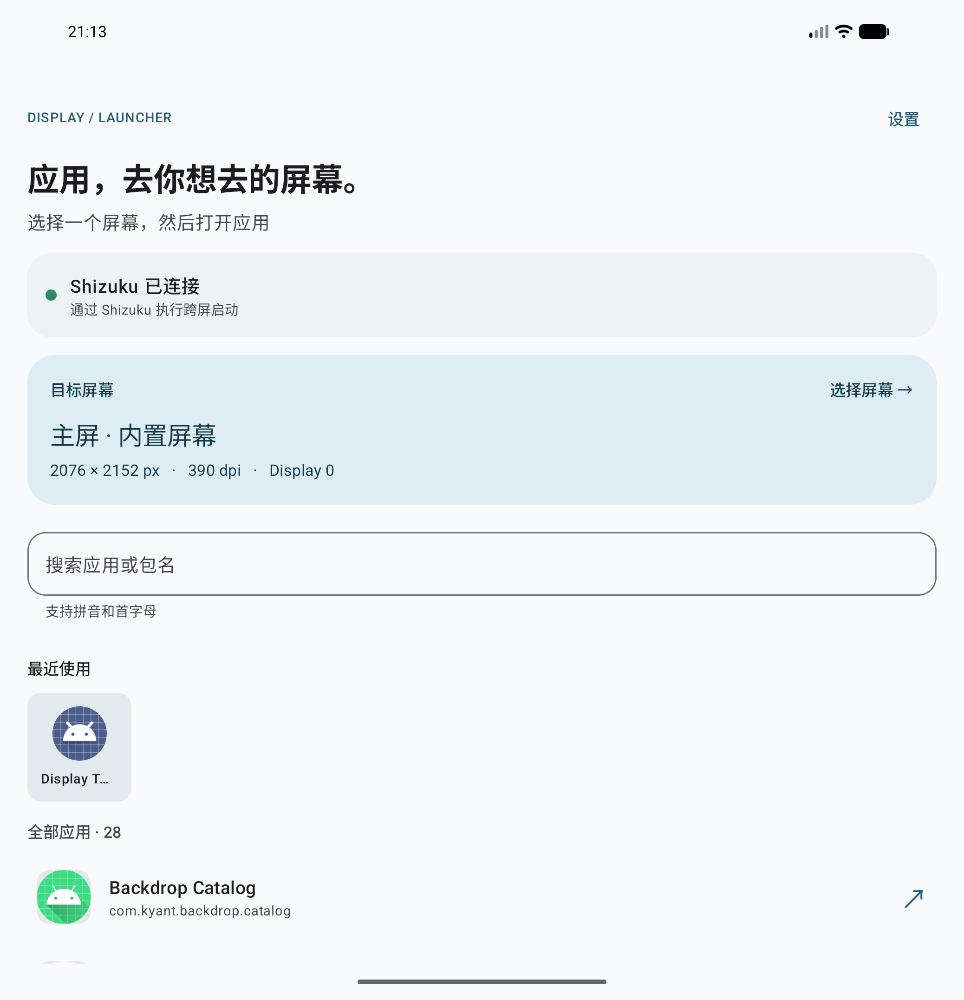
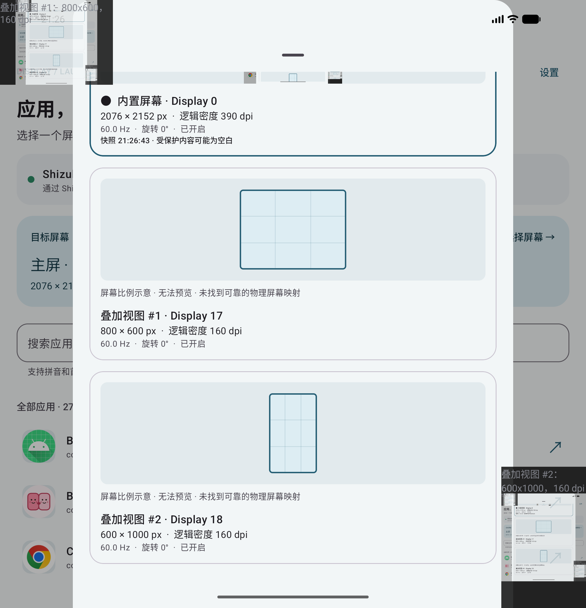

<p align="center">
  
</p>

<h1 align="center">Display Launcher</h1>

<p align="center">选择一个屏幕，让应用在你想要的位置打开。</p>

Display Launcher 是基于 Shizuku 的第三方 Android 多屏应用启动工具。它列出系统已有的屏幕，让你查看屏幕信息、搜索应用，并向所选屏幕发起启动请求。

适用于需要在外接屏、桌面模式或车联虚拟屏之间选择启动位置的场景。屏幕是否可用、应用最终在哪里打开，取决于系统和目标应用的支持情况。

本项目独立开发，非 Shizuku 或手机、车机厂商的官方客户端，与相关厂商无隶属关系。

## 功能

- **选择目标屏幕**：查看分辨率、逻辑 DPI、刷新率、旋转角度和屏幕状态。
- **快照预览**：支持可可靠映射的物理屏与部分虚拟屏；无法截图时显示按像素宽高绘制的等比示意图，并说明原因。
- **应用搜索**：支持应用名、包名、无声调拼音和首字母，例如 `微信`、`weixin`、`wx`；支持多个关键词组合搜索。
- **最近使用**：按应用去重并置顶，仅记录本工具发起且系统接受的启动。默认显示 3 个，可设置为 0～20 个。
- **快速加载**：先显示本地应用目录缓存，再后台校验；图标按需异步加载。
- **启动结果与诊断**：区分已确认目标屏幕、位置未确认、实际屏幕不符和启动失败，支持复制诊断信息。
- **Material 3 界面**：支持浅色、深色主题，以及 Android 风格的设置页。

<details>
<summary>界面预览</summary>

<p>
  
  
</p>

截图来自测试环境，应用列表和屏幕信息以实际设备为准。模拟屏幕无法获取快照时，会按实际宽高显示等比示意图。

</details>

## 使用要求

- Android 11（API 30）或更高版本。
- 已安装、运行并授权的 [Shizuku](https://shizuku.rikka.app/download/)，版本要求为 v13 或以上。
- 如需向副屏启动应用，系统必须已创建并向本应用暴露相应 Display。

非 root 设备可通过无线调试启动 Shizuku。设备重启后通常需要重新启动 Shizuku。

应用目录、搜索和设置不依赖 Shizuku 授权；跨屏启动与快照预览需要授权。

## 安装与使用

正式版从 [GitHub Releases](https://github.com/seasonyuu/android-display-launcher/releases) 下载，安装附件中的 `DisplayLauncher-<版本>-release.apk`。每次发布同时提供 `SHA256SUMS` 和 `version.json`，用于核对文件、版本、提交及签名指纹。

主分支的 Debug 构建可在 [Android CI](https://github.com/seasonyuu/android-display-launcher/actions/workflows/ci.yml) 成功运行的 Artifacts 中下载，保留 14 天；PR 仅检查代码，不提供 APK。仓库为私有时，下载需要仓库访问权限。

1. 安装 APK，并启动 Shizuku。
2. 打开 Display Launcher，点击 **连接 / 授权**，允许使用 Shizuku。
3. 点击 **目标屏幕**，根据快照、示意图和屏幕参数选择目标。
4. 搜索应用并点击其入口，查看启动结果；遇到异常时可打开 **查看诊断**。
5. 在右上角 **设置 → 最近使用数量** 中调整首页显示数量。设置为 0 可隐藏该区域，不会删除历史记录。

搜索时会隐藏最近使用，点击 **清空** 后恢复。最近使用记录在各屏幕间共享，点击最近应用时使用**当前选择的屏幕**。

## 兼容性与限制

Display Launcher 向系统发起启动请求，不会创建虚拟屏，也不会替换系统桌面、强停应用、强制多开或迁移已有任务。

| 情况 | 说明 |
| --- | --- |
| 只有主屏可选 | 系统没有向本应用提供其他可用 Display；请先检查外接屏、桌面模式或车联功能。 |
| 应用仍在主屏或其他屏幕打开 | 系统策略、目标应用的启动模式或已有任务可能影响启动位置。 |
| 提示“屏幕位置未确认” | 启动请求已完成，但系统返回的信息不足以可靠确认实际位置。 |
| 屏幕只有比例示意图 | 可能没有有效输出 Surface、无法建立可靠映射，或截图受到系统限制；不代表一定无法向该屏启动应用。 |
| 快照中部分内容空白 | 受保护内容可能无法捕获。截图能力与应用启动能力分别受系统控制。 |

目前已在 Android 16 / API 36 模拟器上验证主要流程，并在 vivo V2547A（设备报告 Android 17 / API 37）上验证车联虚拟屏截图。不同 ROM、车联系统和系统版本的行为可能不同；最低支持版本不代表所有版本均已实机验证。具体测试范围见 [验证记录](VALIDATION.md)。

拼音采用 Android ICU 的默认读音，不包含自定义多音字词库或模糊纠错。

## 隐私与本地数据

- 不申请“使用情况访问”权限，不读取或推断其他来源的应用使用历史。
- 最近使用和设置保存在应用私有目录，不上传；历史最多保存 50 个应用，改变显示数量不会截断历史。
- 应用目录与图标位于可清理的缓存目录。清除缓存后会重新加载，不影响已保存的设置和最近使用记录。
- 屏幕快照只在选择器打开期间暂存，不上传，也不写入相册。
- 项目已禁用应用备份和设备间数据迁移；卸载或清除应用数据会删除本地记录。

提交问题时，请先检查诊断信息或截图，隐去不希望公开的应用信息和屏幕内容。

## 从源码构建

### 环境

- JDK 21 和 Git；需完整克隆仓库及 tags，不支持浅克隆或无 Git 元数据的源码 ZIP。
- Android SDK Platform 36，以及 Android SDK Platform-Tools。
- 使用仓库内的 Gradle Wrapper，无需单独安装 Gradle。

在 Android Studio 中打开项目，或配置 `ANDROID_HOME` / 本地 `local.properties` 中的 `sdk.dir`，先按下文配置本机签名，再在项目根目录执行：

```sh
./gradlew :app:assembleDebug --no-configuration-cache
```

输出 APK：

```text
app/build/outputs/apk/debug/app-debug.apk
```

安装到已连接的设备：

```sh
adb install -r app/build/outputs/apk/debug/app-debug.apk
```

Windows 使用 `gradlew.bat`。连接多台设备时，为 adb 命令添加 `-s <设备序列号>`。Release 使用同一套签名配置，可运行 `./gradlew :app:assembleRelease --no-configuration-cache` 构建。

### Git 版本

主应用和测试目标的版本均来自 Git：

- 正式 tag 格式为 `vX.Y.Z`，干净工作区位于该 tag 时版本名为 `X.Y.Z`。
- tag 后的开发提交形如 `0.1.0-dev.3+gabc1234`；首次 tag 前以 `0.1.0` 为基线。
- Debug 增加 `-debug` 后缀；未提交的本地修改标记为 `-dirty`。
- `versionCode` 等于完整历史的提交总数。禁止移动已发布 tag 或重写发布分支历史，正式发布的版本与 versionCode 均须递增。
- 使用 `./gradlew versionInfo` 查看版本，机器可读信息输出到 `build/version.json`。自定义 ValueSource 会使配置缓存感知 Git 版本变化。

### 本机签名

Debug 和 Release 均保持 `me.seasonyuu.displaylauncher` 包名，使用同一套签名。项目维护者的签名保存在仓库外：

```text
~/.android/keystores/android-display-launcher/release.jks
~/.android/keystores/android-display-launcher/signing.properties
```

签名配置格式（请替换为自己的值，不要提交到仓库）：

```properties
storeFile=/absolute/path/to/release.jks
storePassword=<keystore password>
keyAlias=display-launcher
keyPassword=<key password>
```

也可通过 `SIGNING_PROPERTIES_FILE` 指定配置文件。CI 使用 `RELEASE_KEYSTORE_FILE`、`RELEASE_STORE_PASSWORD`、`RELEASE_KEY_ALIAS`、`RELEASE_KEY_PASSWORD` 环境变量，优先级高于本机配置。

贡献者可以使用 `keytool -genkeypair -keystore release.jks -storetype JKS -alias display-launcher -keyalg RSA -keysize 4096 -validity 10000` 交互生成自己的签名；这不会取得官方安装包的升级身份。仅运行编译、单元测试和 Lint 不需要签名，打包 APK 时缺少配置则明确报错。签名构建请使用 `--no-configuration-cache`，不要上传本机 Gradle 缓存。

维护者应离线备份 keystore 和密码；丢失后无法继续以同一签名更新已安装的应用。新签名无法覆盖早期默认调试签名的安装包，首次切换需要卸载旧包；此后的统一签名 Debug/Release 可相互覆盖安装，但不能直接安装较低 versionCode。

### 自动构建与发布

- `Android CI`：main 推送、面向 main 的 PR、手动触发。运行 Git 版本测试、应用单元测试、编译与 Lint；只有 main 构建使用签名并上传 Debug APK。手动签名构建也仅允许 main。
- `Tagged Release`：推送 `v*` tag 后验证严格版本格式、main 历史归属和递增版本，测试通过后构建 Release。使用草稿上传 APK、校验文件和版本元数据，最后发布；不覆盖已发布版本。
- 云端不运行依赖 Shizuku 或 vivo 车联环境的设备测试。

仓库需要配置 `RELEASE_KEYSTORE_BASE64`、`RELEASE_STORE_PASSWORD`、`RELEASE_KEY_ALIAS`、`RELEASE_KEY_PASSWORD` 四项 Actions Secrets。密钥只提供给可信的主分支和 tag 构建；PR 不读取签名。Release 通过 `GITHUB_TOKEN` 发布，不需要额外 PAT。

发布前，确认 main 的 CI 成功，再为对应提交创建 annotated tag 并推送（以下为后续版本示例）：

```sh
git tag -a v0.1.1 <已验证的提交SHA> -m "Display Launcher v0.1.1"
git push origin v0.1.1
```

已发布 Release 禁止自动替换；失败留下的同提交草稿允许重跑恢复。请在 Actions 中检查任务结果，并核对 Release 的 APK 和签名指纹。

### 检查与测试

```sh
./gradlew -p buildSrc test
./gradlew :app:testDebugUnitTest :app:lintDebug
```

构建设备测试 APK 和独立测试目标：

```sh
./gradlew :app:assembleDebugAndroidTest :test-target:assembleDebug
```

设备测试包含需要 Shizuku 授权、测试目标或特定 vivo 车联屏的用例；部分用例会临时创建模拟屏，或安装、禁用、卸载独立测试包。请在测试设备上按 [验证记录](VALIDATION.md) 中对应环境的命令运行。

## 开发说明

项目使用 Kotlin、Jetpack Compose / Material 3、Coroutines / Flow、Preferences DataStore 和 Shizuku。

| 目录 | 内容 |
| --- | --- |
| [`app/`](app/) | 主应用、应用目录与图标缓存、最近使用、屏幕选择、Shizuku UserService 和测试。 |
| [`test-target/`](test-target/) | 独立测试应用，包含普通、singleTask、跳转和受保护窗口入口，不打包进主应用。 |
| [`assets/branding/`](assets/branding/) | 当前应用图标、商店图标源文件与生成说明。 |
| [`scripts/`](scripts/) | 商店图标导出脚本。 |
| [`docs/images/`](docs/images/) | README 使用的界面截图。 |

应用自有包名：

- 主应用：`me.seasonyuu.displaylauncher`
- 测试目标：`me.seasonyuu.displaylauncher.fixture`
- Instrumentation APK：`me.seasonyuu.displaylauncher.test`

`LauncherModel` 组织界面状态；`AppRepository` 共享应用目录并加载图标；`RecentStore` 保存最近使用与设置。`PrivilegedService` 通过 AIDL 执行启动与截图，`ShellProtocol` 负责解析系统输出。

启动使用当前用户的 Launcher Intent 和系统 `cmd activity start-activity --display` 接口。截图仅在逻辑屏与 SurfaceFlinger 输出之间存在可靠映射时执行；映射歧义、输出消失或未知格式会回退到示意图。服务校验调用 UID，不提供任意 shell 命令执行接口。

<details>
<summary>早期测试版迁移说明</summary>

当前包名为 `me.seasonyuu.displaylauncher`。更换包名前安装的测试版会被系统视为另一个应用，可以与当前版本并存；设置、最近使用和 Shizuku 授权不会自动迁移，需要在当前版本重新授权。

</details>

## 问题反馈与贡献

欢迎通过 GitHub Issues 提交问题或建议，通过 Pull Request 参与改进。

报告兼容性问题时，请尽量提供：

- 手机型号、Android / ROM 版本、应用版本及 Shizuku 版本。
- 屏幕来源，例如 HDMI 外接屏、系统桌面模式或车联虚拟屏。
- 复现步骤、预期行为、实际结果，以及脱敏后的诊断信息。
- 若问题只影响某个应用，请附上其包名和版本。

提交代码前请运行相关单元测试与 Lint。修改屏幕映射、启动核验或 Shizuku 通信时，请补充对应测试，并说明实际验证过的设备与系统版本。

## 致谢与资源

- [Shizuku](https://shizuku.rikka.app/) 为跨屏启动与快照功能提供特权服务能力。
- Android Jetpack、Compose 和 Material 3 提供应用架构与界面组件。
- 应用图标由 AI 辅助生成，当前资源、提示词和导出方式见 [图标说明](assets/branding/README.md)。

## 许可证

Copyright 2026 SeasonYuu.

本项目采用 [Apache License 2.0](LICENSE)（SPDX：`Apache-2.0`）。你可以在遵守许可证条件的前提下使用、修改和分发本项目，包括商业用途。分发时需附带许可证、保留适用声明，并注明对文件的修改；具体权利与义务以许可证全文为准。

第三方依赖及其资源仍遵循各自的许可证，本项目许可证不替代其原有授权。
